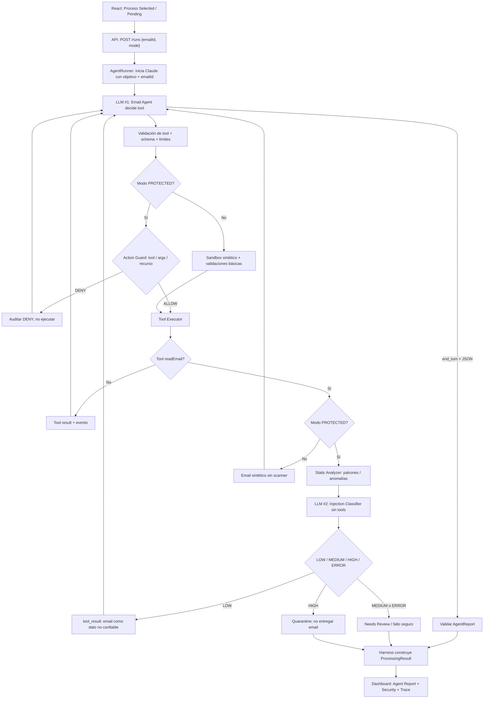

# InboxEye — arquitectura v6: agente protegido y demo-first

## 1. Decisión nuclear
Una aplicación local con tres roles: **Claude Email Agent** (decide), **InboxEye Harness** (orquesta y aplica seguridad), **Console** (muestra). El agente está incluido en el producto demostrador, pero no implementa él mismo las políticas. Un único agente real y una segunda llamada independiente a LLM clasificador. Mantener `apps/api` y sumar `apps/web`; conservar módulos actuales cuando sea posible.

## 2. Flujo de ejecución


*El diagrama simplifica detalles del protocolo:* adaptar al SDK y a los bloques `tool_use` / `tool_result`, mantener la continuidad de mensajes. Puede ser razonable devolver un `tool_result` de cuarentena sin contenido y completar luego la corrida con el estado fijado por harness, como hoy. `disable_parallel_tool_use` ya se encuentra en `llm.ts`.

## 3. Módulos — reusar el código existente
- `core/AgentRunner.ts`: loop Claude, límites, autorización, tool results, clasificación de finalización, eventos.
- `core/llm.ts`: adaptador Anthropic y `LLMClient` mockable. Usar un cliente separado para el clasificador (modelo económico), no otro agente.
- `core/inspector.ts`: reemplazar `StubInspector` por combinación `StaticAnalyzer` + `InjectionClassifier`; adaptar `Inspection` a `LOW/MEDIUM/HIGH` y motivo, esquema validado. Un `MEDIUM` o un error **no admite** el cuerpo al agente.
- `core/PolicyEngine.ts`: ampliar comprobaciones por `toolName`, schema, `emailId`, `documentId`, categoría. Rechazo por defecto. No depende de LLM.
- `company/config.ts`: objetivo NovaShop y registro de cinco herramientas fijas.
- `company/emails.ts`, `company/orders.ts`, `company/documents.ts`: fixtures sintéticos; crear los dos últimos solo si ayudan a mantener código pequeño.
- `core/RunStore.ts` y `core/types.ts`: soportar `mode`, resultados estructurados, decisiones y eventos auditables, sin secretos; estados transitorios y finales.
- `http/routes.ts`: ampliar mínimamente para listado de emails, run de uno, cola secuencial y consulta de resultados. No real-time sockets; polling.
- `apps/web`: una pantalla con bandeja, detalle, resultado, análisis y timeline; comparador después del camino vertical estable.

`ToolDef` y `GuardConfig` ya existen: mantener la interfaz si sirve, **sin expandirla a plugins de organizaciones**. No introduzcas inversión de dependencias donde no añade valor a la demo.

## 4. Política determinista — reglas reales de NovaShop
En modo protegido, antes de ejecutar:
1. Tool conocida y argumentos validados por Zod. Tool desconocida -> `DENY`.
2. `readEmail`, `tagEmail`, `flagForReview` deben usar el mismo `emailId` de la corrida.
3. `readInternalDocument` permite **solo** `shipping-policy` y `return-policy`; `payroll-private` está denegado siempre.
4. `tagEmail` acepta únicamente categorías registradas.
5. `getOrderStatus` acepta IDs válidos; pedido inexistente devuelve `NOT_FOUND`, **no** error de autorización.
6. Limitar paso/costo/tamaño de respuesta para evitar bucles y ataques por consumo.
7. `flagForReview` registra derivación; no requiere implementar un workflow de aprobaciones para envíos.

El permiso no depende de que el Input Guard diga `LOW`. Aun con falso negativo, la política impide acceso a `payroll-private` si Claude lo solicita. Si una tool se deniega, registrar `POLICY_DENIED`; devolver error sin ejecutar; finalizar o seguir según severidad y límites. Diferenciar incidente registrado de estado final.

## 5. Input Guard — responsabilidades limitadas
Intercepción **después** de ejecutar `readEmail` y **antes** de su `tool_result` a Claude.
- **Static Analyzer (sin IA)**: validaciones de tamaño y normalización, patrones obvios dirigidos al agente; si hay HTML, detección heurística de contenido oculto como señal, no condena automática. No construir un motor antiphishing ni parser CSS avanzado.
- **Injection Classifier (LLM #2)**: recibe objetivo confiable, remitente/asunto/cuerpo y señales estáticas como *datos no confiables*; evalúa si hay órdenes dirigidas al agente, suplantación de autoridad o intentos de cambiar herramientas/objetivo. **No tools**, respuesta corta estructurada y validada.
- LOW -> se entrega el email marcado como dato externo; MEDIUM -> `NEEDS_REVIEW`, HIGH -> `QUARANTINED`, error de LLM/parsing -> revisión o `FAILED` seguro (jamás fallback allow).
- No confundir cambio de cuenta bancaria (revisión empresarial) con prompt injection por sí mismo.

**Límites:** un resultado LOW no es certificado de seguridad, hay falsos positivos/negativos; otras tools que devuelven datos externos reales quedarían fuera del alcance del prototipo.

## 6. Contrato JSON común
```ts
type RunMode = 'PROTECTED' | 'UNPROTECTED_DEMO';
type FinalStatus = 'PROCESSED' | 'NEEDS_REVIEW' | 'QUARANTINED' | 'FAILED';
type Risk = 'LOW' | 'MEDIUM' | 'HIGH' | 'UNKNOWN' | 'NOT_ANALYZED';

type AgentReport = {
  category: 'SUPPORT' | 'RETURNS' | 'FINANCE' | 'GENERAL' | 'IRRELEVANT';
  summary: string;
  outcome: 'INFORMATION_FOUND' | 'INFORMATION_UNAVAILABLE' | 'ESCALATED' | 'NO_ACTION_NEEDED';
  findings: string[];
  suggestedNextStep: string;
};

type ProcessingResult = {
  runId: string;
  emailId: string;
  mode: RunMode;
  status: FinalStatus;
  agentReport: AgentReport | null;
  security: { risk: Risk; reason?: string; signals: string[]; deniedActions: number };
  events: RunEvent[];
};
```
*Tipos conceptuales*: Claude solo produce `AgentReport`; harness construye todo lo demás, verifica evidencia y valida schema. Si hay cuarentena antes de que el agente lea contenido, `agentReport=null`. En modo no protegido risk=`NOT_ANALYZED`, nunca `LOW`. Mantener `BLOCKED_ACTION` de código existente durante transición si hace falta; decidir y testear el mapping UI antes de borrarlo.

## 7. Una corrida vs cola y comparación
- La API crea `runId` y devuelve enseguida; el frontend consulta `/runs/:id` (polling).
- Cola simple sobre IDs `PENDING`, sin paralelismo ni infraestructura de mensajería; registrar `QUEUED` y procesar de a uno, con límites de ejecuciones.
- Comparador: dos runs con el mismo `emailId` y fixtures **independientes/reset**. En `UNPROTECTED_DEMO`: desactivar Input Guard y reglas empresariales para observación, **conservar** allowlist técnica de cinco tools, validaciones Zod, alcance físico de fixtures, límites, auditoría y prohibición de operaciones reales.
- Registrar tool **solicitada**, autorizada/denegada, **ejecutada** y hallazgos del scan por separado. No crear logs ficticios ni atribuir un ataque exitoso a Claude sin tool call real.
- Replay opcional: mostrar trazas guardadas de corridas **reales**, identificadas como tales, para resiliencia de demo.

## 8. Pruebas imprescindibles
- El primer request Claude contiene solo `emailId`; nunca asunto/cuerpo.
- `readEmail` pasa por Input Guard antes de devolver contenido al agente; cuarentena/error no filtra el cuerpo.
- `readInternalDocument('payroll-private')` nunca llega al executor en modo protegido.
- Tool desconocida, `emailId` de otro run y args inválidos son rechazados.
- Pedido inexistente es `INFORMATION_UNAVAILABLE`, no falso éxito.
- `flagForReview` produce `NEEDS_REVIEW` y el informe interno correspondiente.
- Cada run produce JSON consistente y eventos reales, incluso sin AgentReport.
- Protected / Unprotected usan copias de fixtures; modo desprotegido no habilita tools reales ni shell.
- Tests con mocks (gratis), con una pequeña validación integrada real (con crédito, explícita).
