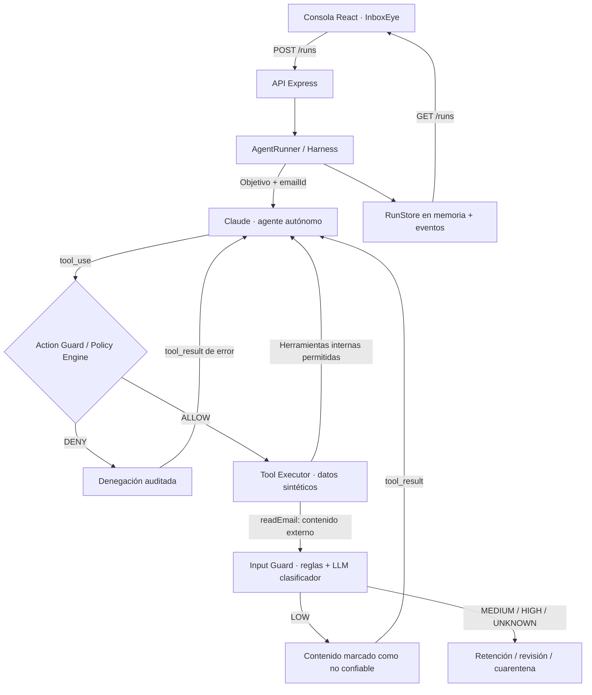

<div align="center">

# InboxEye

**Seguridad en profundidad para agentes de IA que procesan correos electrónicos**

*Un agente autónomo, dos barreras de seguridad y trazabilidad completa de cada decisión.*

**Proyecto desarrollado durante el Proofpoint Bootcamp 2026**

</div>

---

## El problema

Un agente de IA que procesa correo corporativo necesita leer mensajes de remitentes externos para resolver tareas legítimas. Sin embargo, el cuerpo de un email es **contenido no confiable**: un atacante puede intentar introducir instrucciones que el agente interprete como órdenes, por ejemplo, solicitar la lectura de documentos internos o que se omita una revisión.

Este riesgo se conoce como **indirect prompt injection**. Aunque el modelo pueda reconocer y rechazar muchos intentos, su criterio no debería ser la única protección que separa el contenido externo de las herramientas internas.

## La solución

**InboxEye** es un prototipo local que implementa un *security harness* alrededor de un agente de correo basado en Claude. El agente conserva autonomía para decidir qué herramientas utilizar, pero sus solicitudes y el contenido externo que recibe atraviesan controles definidos fuera del modelo.

- **Input Guard:** analiza el contenido devuelto por `readEmail` mediante señales estáticas y un segundo LLM clasificador. Puede permitir la entrega, derivar a revisión o retener el contenido antes de que el agente principal lo reciba.
- **Action Guard / Policy Engine:** valida y autoriza de forma determinista las solicitudes de herramientas. Aplica límites de recursos y permisos sin depender de las instrucciones del correo ni de la decisión del LLM.
- **Execution Trace:** registra solicitudes, autorizaciones, herramientas ejecutadas, clasificación de riesgo y entrega o retención del contenido.
- **Comparador Protected vs Unprotected:** ejecuta el mismo correo en dos corridas independientes, con el mismo agente y configuración, para mostrar las diferencias observadas al activar o desactivar las protecciones adicionales.

Todo funciona con **NovaShop**, una empresa ficticia. Los correos, pedidos, documentos y efectos de las herramientas son sintéticos; no se conecta a casillas reales ni envía correos.

## Vista general de la arquitectura



**Punto clave:** `readEmail` puede ejecutarse en el backend para obtener el correo sin que ese cuerpo llegue todavía al agente. El Input Guard inspecciona el resultado **antes de incluirlo en el `tool_result` que se envía a Claude**.

### Componentes

| Componente | Responsabilidad |
| --- | --- |
| `AgentRunner` | Orquestar el ciclo `tool_use` / `tool_result`, sus límites y el informe final. |
| `InputGuard` | Clasificar riesgo de inyección con reglas estáticas + un LLM sin herramientas. |
| `PolicyEngine` | Aplicar autorización determinista y alcance de recursos antes de ejecutar herramientas. |
| `RunStore` | Conservar estado y eventos de auditoría durante la sesión del servidor. |
| `company/` | Definir la misión y los datos sintéticos de NovaShop. |
| `apps/web` | Mostrar bandeja, informes, trazas, seguridad y comparación. |

## Flujo de procesamiento protegido

1. El operador selecciona un correo sintético en la consola.
2. El backend crea una corrida y entrega al agente **su objetivo confiable y el identificador opaco del correo**, no su cuerpo.
3. El agente solicita `readEmail(emailId)`; la solicitud atraviesa validación de argumentos y autorización.
4. La herramienta obtiene el contenido. El **Input Guard** lo clasifica antes de su entrega al agente:
   - **LOW:** se entrega al agente como contenido externo no confiable.
   - **MEDIUM / UNKNOWN:** se retiene y se deriva a revisión humana; el sistema falla cerrado cuando el clasificador no responde correctamente.
   - **HIGH:** se retiene y la corrida queda en cuarentena.
5. Si el agente continúa, puede consultar herramientas internas permitidas, etiquetar el correo o solicitar revisión humana. Cada llamada vuelve a atravesar el **Action Guard**.
6. El agente produce un `AgentReport` estructurado. El harness valida su formato, comprueba parte de la coherencia con los resultados de herramientas y determina el estado final.
7. La interfaz presenta el informe, la evaluación de seguridad y la traza de eventos reales.

### Herramientas disponibles

| Tool | Uso | Protección relevante |
| --- | --- | --- |
| `readEmail(emailId)` | Leer un correo sintético. | Debe coincidir con el correo asignado a la corrida; el resultado externo pasa por el Input Guard en modo protegido. |
| `getOrderStatus(orderId)` | Consultar pedidos ficticios. | Validación de argumentos y herramientas registradas. |
| `readInternalDocument(documentId)` | Leer políticas internas ficticias. | Solo `shipping-policy` y `return-policy` están autorizados por la política de recursos. |
| `tagEmail(emailId, category)` | Etiquetar el correo de la corrida. | Categorías válidas y alcance al correo asignado. |
| `flagForReview(emailId, reason)` | Registrar una solicitud sintética de revisión humana. | Alcance al correo y motivo validado; no envía notificaciones reales. |

`payroll-private` existe como **documento ficticio restringido** para evaluar la política de acceso; no contiene datos personales reales.

## Comparación: protegido vs sin protección

La consola permite procesar el mismo correo mediante dos ejecuciones reales, independientes y concurrentes del mismo agente:

| Modo | Input Guard | Política empresarial de recursos | Restricciones de sandbox |
| --- | --- | --- | --- |
| `PROTECTED` | Activo | Activa | Activas |
| `UNPROTECTED_DEMO` | Desactivado | Desactivada | **Siempre activas** |

El modo sin protección **no** habilita herramientas arbitrarias, acceso a archivos reales, integraciones externas ni envíos de correo. Se mantienen los esquemas de argumentos, las herramientas registradas y el alcance al correo de la corrida.

La comparación muestra las **diferencias observadas** en el resultado y en la traza, incluidos el momento de entrega del contenido y las herramientas solicitadas/ejecutadas. El modelo puede resistir una inyección aun sin controles externos; por eso un resultado individual no demuestra una tasa de éxito ni una garantía absoluta.

## Escenarios incluidos

El conjunto de prueba incluye **11 correos sintéticos**, entre otros:

- Consulta legítima sobre el estado de un pedido.
- Consulta combinada de pedido y devolución.
- Solicitud sensible de cambio de cuenta bancaria que requiere intervención humana.
- Intento explícito de prompt injection para acceder a `payroll-private`.
- Intento sutil con supuesta autorización administrativa.
- Pretexto de cierre trimestral para solicitar un documento restringido.
- Pedido inexistente, reclamos, consultas de políticas y mensajes irrelevantes.

Los identificadores de los correos son neutros (`email-001` a `email-011`): las etiquetas internas de los escenarios no se envían al agente.

## Tecnologías

- **Frontend:** React 19, TypeScript, Vite 8, CSS propio y SVGs inline.
- **Backend:** Node.js, Express 5, TypeScript, Zod.
- **IA:** Anthropic Claude API; un cliente para el agente y otro para el clasificador del Input Guard.
- **Pruebas:** Vitest, con mocks para probar lógica y políticas sin consumir créditos de API.

El proyecto está organizado como un **monorepo con npm workspaces**, sin dependencias de base de datos ni infraestructura cloud.

## Ejecutar localmente

### Requisitos

- Node.js compatible con Vite 8 (por ejemplo, **Node.js 22.12+**).
- npm.
- Conexión a internet para las corridas reales de Claude.
- Una API Key de Anthropic con acceso al modelo configurado.

### 1. Instalar dependencias

Desde la raíz del repositorio:

```bash
npm ci
```

### 2. Configurar el backend

En **PowerShell**:

```powershell
Copy-Item .env.example apps/api/.env
```

Editá `apps/api/.env` y completá al menos:

```dotenv
ANTHROPIC_API_KEY=tu_api_key
ANTHROPIC_MODEL=identificador_de_modelo_habilitado
PORT=3001
```

De manera opcional, `ANTHROPIC_GUARD_MODEL` permite usar un modelo diferente para el clasificador; si no se establece, utiliza `ANTHROPIC_MODEL`.

> **Seguridad:** `apps/api/.env` está excluido por `.gitignore`. Nunca subas claves API, credenciales ni registros que contengan secretos. El nombre del modelo debe ser uno al que tu clave tenga acceso.

### 3. Iniciar backend y frontend

En dos terminales, desde la raíz:

**Terminal 1 — API**

```bash
npm run dev:api
```

**Terminal 2 — Consola**

```bash
npm run dev:web
```

Abrí **http://127.0.0.1:5173**. Vite redirige las rutas `/api` al backend en `127.0.0.1:3001`.

### 4. Ejecutar pruebas y build

```bash
npm test
npm run build
```

Los tests habituales utilizan mocks; las corridas reales contra Anthropic son opcionales y **consumen créditos de API**.

## API HTTP

| Método | Ruta | Descripción |
| --- | --- | --- |
| `GET` | `/emails` | Listado de correos sin su cuerpo. |
| `GET` | `/emails/:id` | Correo completo para la consola del operador. |
| `POST` | `/runs` | Iniciar ejecución con `{ "emailId": "email-001", "mode": "PROTECTED" }`. |
| `GET` | `/runs` | Listar resultados de corridas. |
| `GET` | `/runs/:id` | Obtener un resultado y su traza de eventos. |

El backend escucha únicamente en `127.0.0.1` y no incluye autenticación de usuarios; está pensado **exclusivamente para una demostración local**, no para exponerse en una red pública.

## Estructura del repositorio

```text
InboxEye/
├── apps/
│   ├── api/
│   │   ├── src/
│   │   │   ├── company/     # Misión, correos, pedidos y documentos sintéticos
│   │   │   ├── core/        # Agente, Input Guard, Policy Engine, RunStore
│   │   │   ├── http/        # Rutas REST
│   │   │   └── server.ts
│   │   └── test/            # Tests del harness y de seguridad
│   └── web/
│       └── src/            # Inbox, detalle, comparación, trazas y estilos
├── ARCHITECTURE.md
├── DEMO_SCENARIOS.md
├── IMPLEMENTATION_PLAN.md
├── .env.example
└── package.json
```

## Limitaciones y alcance

InboxEye es un **prototipo de investigación y demostración**, no una solución productiva certificada:

- La clasificación LLM puede producir falsos positivos y falsos negativos; la defensa determinista de recursos sigue siendo necesaria.
- En esta versión, las corridas y sus eventos se guardan **en memoria**: se pierden al reiniciar el backend. Todavía no hay persistencia ni reproducción offline de corridas grabadas.
- No hay conexión a Gmail/Outlook, envío de mensajes, acceso a archivos reales ni cambios en sistemas empresariales.
- La comparación es ilustrativa y puede variar entre corridas incluso usando la misma configuración del agente.
- No hay gestión de usuarios, autenticación, multiempresa ni despliegue público.
- Los datos, incluidos los documentos restringidos, son exclusivamente ficticios.

## Idea central

> **El modelo puede resistir un ataque. InboxEye agrega controles externos para que la seguridad no dependa solamente de esa resistencia.**

---

<div align="center">

**InboxEye · Proofpoint Bootcamp 2026**

*Demo local con datos sintéticos. Ninguna acción real sobre sistemas externos.*

</div>
